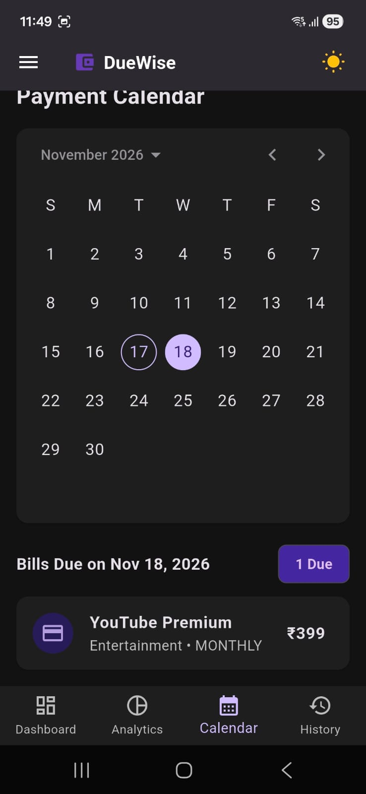
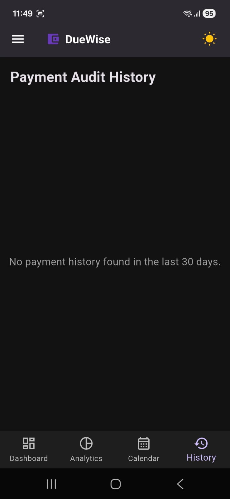

# 🌟 DueWise – Smart Subscription & Bill Tracker

> Never miss a payment again! **DueWise** is a cross-platform subscription and bill management application built with **Flutter** and a **Python FastAPI + Groq AI agent**. Track recurring subscriptions, get timely payment reminders, monitor free trials, sync across devices, and manage or query your bills through a conversational AI assistant.

---

## ✨ Key Features

### 🤖 AI Chatbot Assistant (DueWise AI Assistant)

Chat naturally in plain English to add subscriptions or inspect your bills without navigating through multiple screens.

- **Add Subscriptions via Chat (`add_subscription`):** Create new subscriptions using natural language. The assistant extracts the title, amount, billing cycle (`MONTHLY`, `YEARLY`, or `CUSTOM` interval in days), start date, and category (`Entertainment`, `Utility`, `Software`, `Gym`, `Insurance`, `Education`, `Other`).

- **Query Bills & Expenses via Chat (`query_subscriptions`):** Ask questions about your existing subscriptions and receive answers based on your subscription data.

#### Supported Queries & Example Prompts

| Query Type | Example Prompts |
|---|---|
| Today's Dues (`due_today`) | "What subscriptions are due today?" / "Do I have any bills due today?" |
| Specific Date Dues (`due_on_date`) | "What subscriptions are due on November 25, 2026?" / "Any bills due on 2026-12-01?" |
| Upcoming Renewals (`upcoming_days`) | "What are my upcoming subscriptions in the next 7 days?" / "Show me bills due in the next 14 days." |
| Calendar-Month Expenses (`this_month_expenses`, `next_month_expenses`) | "What are the expenses this month?" / "What are the expenses next month?" |
| Average Monthly Spend (`monthly_expenses`) | "What are my monthly expenses?" / "How much do I spend per month on subscriptions?" |
| Category Spending (`by_category`) | "Show my Entertainment subscriptions." / "How much am I spending on Gym?" |
| Specific Bill / Service Lookup (`by_name`) | "How much is my Spotify subscription?" / "What is my internet bill?" |
| All Active Subscriptions (`all_active`) | "List all my active subscriptions." |

### 📱 Core Subscription & Expense Management

- **🔄 Multi-Device Sync:** Synchronizes user data across mobile devices and web clients using Firebase Authentication and Cloud Firestore.
- **🔔 Smart Payment Reminders:** Schedules local notifications 3 days before, 1 day before, and on the due date, with reminders at 9:00 AM and 6:00 PM.
- **🎁 Free Trial Tracking:** Highlights active free trials to help users avoid unexpected charges.
- **📊 Analytics & Payment History:** Displays monthly expense breakdowns, financial insights, and a detailed payment history.
- **🌙 Dark & Light Themes:** Provides an adaptive interface with theme switching, built using Flutter and Riverpod.

---

## 📱 App Screenshots

The screenshots are stored in the `duewise_app/screenshots/` directory.

<p align="center">
  
  
  
</p>

<p align="center">
  
  
  
</p>

---

## 🛠️ Tech Stack

| Category | Technologies |
|---|---|
| Frontend | Flutter (Android, iOS, and Web) |
| State Management | Flutter Riverpod |
| AI / Agent Backend | Python, FastAPI, Pydantic, Groq SDK (`openai/gpt-oss-20b`), Uvicorn |
| Authentication | Firebase Authentication |
| Cloud Database | Cloud Firestore |
| Local Storage | Hive |
| Notifications | `flutter_local_notifications`, `timezone` |

---

## 🚀 Getting Started

Follow these steps to set up and run the DueWise Flutter application and Python AI backend locally.

### Prerequisites

Make sure the following tools and accounts are available:

- [Flutter SDK](https://docs.flutter.dev/get-started/install)
- [Dart SDK](https://dart.dev/get-dart) (included with Flutter)
- [Python 3.10+](https://www.python.org/downloads/)
- [Git](https://git-scm.com/downloads)
- A [Groq API key](https://console.groq.com/)
- An IDE such as [VS Code](https://code.visualstudio.com/) or Android Studio

### 1. Clone the Repository

Replace the placeholders with your GitHub username and repository name.

```bash
git clone https://github.com/<your-username>/<your-repo-name>.git
cd <your-repo-name>
```

### 2. Set Up and Run the Python AI Backend

From the repository root, navigate to the Python backend directory. Replace `<backend_folder>` with the actual directory name in your repository.

```bash
cd <backend_folder>

# Create a virtual environment
python -m venv venv

# Activate the virtual environment

# Windows:
venv\Scripts\activate

# macOS / Linux:
source venv/bin/activate

# Install dependencies
pip install fastapi uvicorn pydantic python-dotenv groq
```

Create a `.env` file in the backend directory and add your Groq API key:

```env
GROQ_API_KEY=your_groq_api_key_here
```

**Important:** Keep your API key private. Do not commit the `.env` file to Git.

Start the backend:

```bash
python main.py
```

The server is configured to run at `http://0.0.0.0:8000`.

**API base URL by environment:**

- Android Emulator: `http://10.0.2.2:8000`
- Web or iOS Simulator: `http://localhost:8000`
- Release build: Use your deployed HTTPS backend URL.

### 3. Set Up the Flutter Application

Open a separate terminal. From the repository root, navigate to the Flutter application directory and install its dependencies.

```bash
cd <flutter_app_folder>
flutter pub get
```

Replace `<flutter_app_folder>` with the actual Flutter project directory.

### 4. Configure Firebase

DueWise uses Firebase Authentication and Cloud Firestore. Each developer must configure their own Firebase project before running the application.

1. Create a project in the [Firebase Console](https://console.firebase.google.com/).
2. Register the required application platforms (Android, iOS, and/or Web).
3. Enable **Firebase Authentication** and configure the sign-in methods used by the app.
4. Create or enable **Cloud Firestore**.
5. Install and configure the FlutterFire CLI if it is not already available.
6. Run the following command from the Flutter project directory:

   ```bash
   flutterfire configure
   ```

This generates the platform-specific Firebase configuration, including `lib/firebase_options.dart`.

> **Note:** Firebase project configuration is specific to each developer's Firebase project. Anyone setting up the project locally must complete these steps using their own Firebase configuration.

### 5. Run the Application

From the Flutter project directory, run:

```bash
flutter run
```

To choose a specific connected device:

```bash
flutter devices
flutter run -d <device_id>
```

---

## 🔐 Configuration & Security

- Store secrets such as `GROQ_API_KEY` in environment variables or a local `.env` file.
- Do not commit `.env`, private keys, service-account files, or other credentials.
- Configure Firebase separately for each development environment.
- Use an HTTPS URL for the deployed backend in release builds.

---

## 💡 Made With

Made with 💖 by **Preetika & Nikki**.
