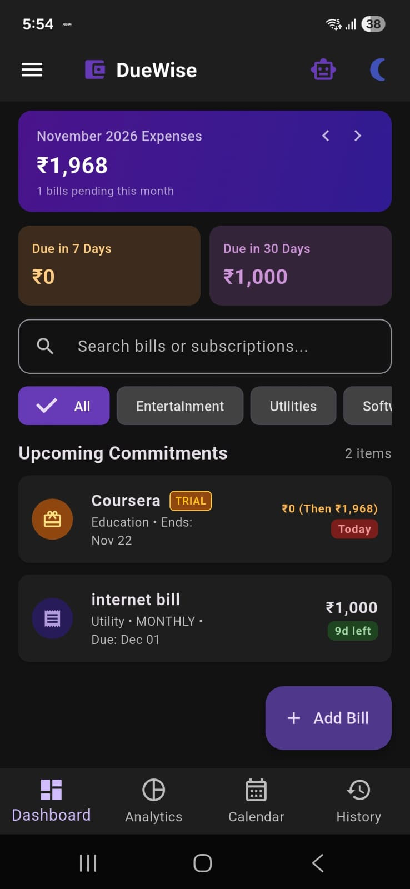
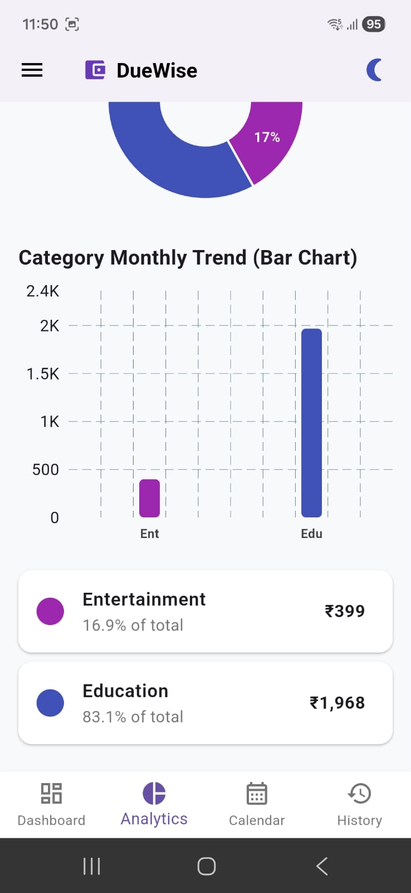
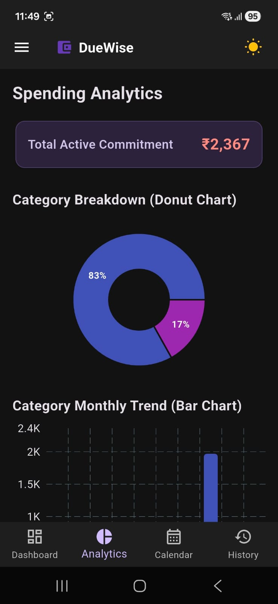
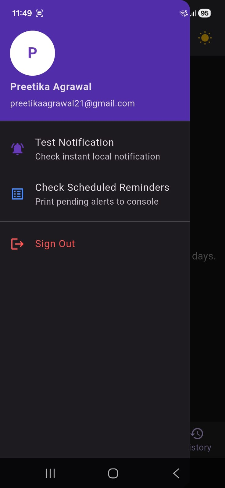

# DueWise – Smart Subscription & Bill Tracker

DueWise is a cross-platform subscription and bill tracking application built with Flutter. It helps users manage recurring subscriptions, one-time bills, payment reminders, and free trials, along with an AI-powered conversational assistant.

The application uses Firebase for authentication and cloud synchronization, while a Python FastAPI backend powers the AI assistant using Groq.

## Features

### 1. Subscription & Bill Management
- Add and manage recurring subscriptions.
- Track one-time bills such as electricity, water, and other payments.
- Choose between Subscription and One-Time Bill modes.
- Edit existing subscriptions and bills.
- Mark one-time bills as paid without affecting recurring billing cycles.
- Track free trials and their conversion dates.

### 2. AI Chatbot Assistant

DueWise includes an AI-powered assistant that allows users to manage and query their subscriptions and bills through natural language.

**Supported actions:**

- **Add Subscription (`add_subscription`):** Add recurring subscriptions with a title, amount, billing cycle, start date, and category.
- **Add One-Time Bill (`add_one_time_bill`):** Add non-recurring bills with a title, amount, category, and due date. These entries do not require a billing cycle or start date.
- **Query Subscriptions (`query_subscriptions`):** Retrieve information about subscriptions and unpaid one-time bills.

**Supported subscription intervals:**
- `MONTHLY`
- `YEARLY`
- `CUSTOM` (specified through interval days)

**Available categories:**
- Entertainment
- Utilities
- Software
- Gym
- Insurance
- Education
- Other

**Conversational clarification support:**

The chatbot maintains recent conversation history and sends it to the backend through the `history` field. This allows it to understand follow-up responses and continue an ongoing request.

For example:
1. User: "Add my Netflix subscription."
2. Assistant: Asks for the amount and billing details.
3. User: "649 per month."
4. Assistant: Uses the previous conversation context to complete the request.

**Supported query intents:**

| Intent | Example queries |
|---|---|
| `due_today` | "What subscriptions are due today?" / "Do I have any bills due today?" |
| `due_on_date` | "What subscriptions are due on November 25, 2026?" |
| `upcoming_days` | "Show my upcoming subscriptions in the next 7 days." / "Show bills due in the next 14 days." |
| `this_month_expenses` | "What are my expenses this month?" |
| `next_month_expenses` | "What are my expenses next month?" |
| `monthly_expenses` | "How much do I spend per month on subscriptions?" |
| `by_category` | "Show my Entertainment subscriptions." / "How much am I spending on Gym?" |
| `by_name` | "How much is my Spotify subscription?" / "What is my internet bill?" |
| `all_active` | "List all my active subscriptions and unpaid bills." |

**Expense calculation and filtering:**
- Paid one-time bills are excluded from active unpaid bill lists.
- One-time bills are excluded from recurring monthly subscription spend estimates.
- One-time bills are included in due, upcoming, and monthly calendar views.

### 3. Reminders & Notifications
- Local notifications for upcoming payment dates.
- Reminders 3 days before, 1 day before, and on the due date.
- Notifications scheduled at 9 AM and 6 PM.

### 4. Cloud Synchronization
- Firebase Authentication for user sign-in.
- Cloud Firestore for storing and synchronizing user data.
- Multi-device synchronization.

### 5. Analytics & Payment History
- View subscription spending analytics.
- Track payment history.
- Monitor recurring expenses and upcoming bills.

### 6. UI & Experience
- Dark and light themes.
- State management using Flutter Riverpod.
- Local data persistence using Hive.

---

## Screenshots

<p align="center">
  
  
  
</p>

<p align="center">
  
  
  
</p>

---

## Tech Stack

| Category | Technologies |
|---|---|
| Frontend | Flutter, Dart |
| State Management | Flutter Riverpod |
| Backend | Python, FastAPI |
| AI Integration | Groq SDK, `openai/gpt-oss-20b` |
| Data Validation | Pydantic |
| Authentication | Firebase Authentication |
| Cloud Database | Cloud Firestore |
| Local Storage | Hive |
| Code Generation | build_runner |
| Notifications | flutter_local_notifications, timezone |
| Server | Uvicorn |

---

## Getting Started

Follow these steps to set up and run DueWise locally.

### Prerequisites

Make sure you have the following installed:

- Flutter SDK
- Dart SDK (included with Flutter)
- Python 3.10+
- Git
- VS Code or Android Studio
- A Groq API key

### 1. Clone the Repository

```bash
git clone https://github.com/<your-username>/<your-repo-name>.git
cd <your-repo-name>
```

### 2. Backend Setup

Navigate to the backend directory:

```bash
cd <backend_folder>
```

Create and activate a Python virtual environment.

**Windows:**
```bash
python -m venv venv
venv\Scripts\activate
```

**macOS / Linux:**
```bash
python -m venv venv
source venv/bin/activate
```

Install the required dependencies:

```bash
pip install -r requirements.txt
```

Create a `.env` file in the backend directory:

```env
GROQ_API_KEY=your_groq_api_key_here
```

Replace the placeholder with your actual Groq API key.

**Important:** Never commit your `.env` file or expose your API key in the repository.

Start the backend server:

```bash
python main.py
```

The backend will be available at:

```text
http://0.0.0.0:8000
```

**API base URL by environment:**

- **Default / Local development:** `http://localhost:8000`
- **Android emulator:** `http://10.0.2.2:8000`
- **Deployed backend:** Pass your deployed HTTPS endpoint through `--dart-define=AI_BACKEND_URL=...` when running or building the app.

The local URLs work out of the box with the default configuration.

### 3. Flutter App Setup

Open a new terminal and navigate to the Flutter application directory:

```bash
cd <flutter_app_folder>
```

Install Flutter dependencies:

```bash
flutter pub get
```

Generate Hive adapters:

```bash
dart run build_runner build --delete-conflicting-outputs
```

### 4. Firebase Configuration

DueWise uses Firebase Authentication and Cloud Firestore for authentication and cloud data synchronization.

Each developer must configure their own Firebase project.

**Setup steps:**

1. Create a project in the [Firebase Console](https://console.firebase.google.com/).
2. Register your application for the required platforms.
3. Enable Firebase Authentication and configure the required sign-in methods.
4. Enable Cloud Firestore.
5. Install and configure the FlutterFire CLI.
6. Run the following command from the Flutter project directory:

```bash
flutterfire configure
```

This generates the `lib/firebase_options.dart` configuration file.

Make sure your Firebase configuration is correctly set up before running the application.

### 5. Run the Application

From the Flutter project directory, start the application using the default local backend configuration:

```bash
flutter run
```

To run the application against a deployed backend URL, pass the URL through `--dart-define`:

```bash
flutter run --dart-define=AI_BACKEND_URL=<your-deployed-url>/api/chat
```

To select a specific connected device:

```bash
flutter devices
flutter run -d <device_id>
```

For a specific device with a deployed backend:

```bash
flutter run -d <device_id> --dart-define=AI_BACKEND_URL=<your-deployed-url>/api/chat
```

---

## Configuration & Security

- Keep the Groq API key in the backend `.env` file.
- Never commit API keys, Firebase service account credentials, or other secrets.
- Keep local backend defaults in the code for convenient development.
- Pass deployed backend URLs at run or build time using `--dart-define=AI_BACKEND_URL=...` instead of hardcoding production URLs in the repository.
- Configure Firebase separately for each development environment.
- Consider implementing API rate limiting and usage caps for production deployments.

---


## Contributors

Made with 💖 by **Preetika & Nikki**